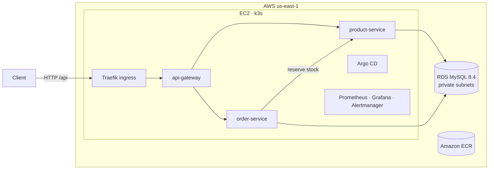
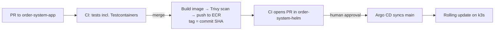
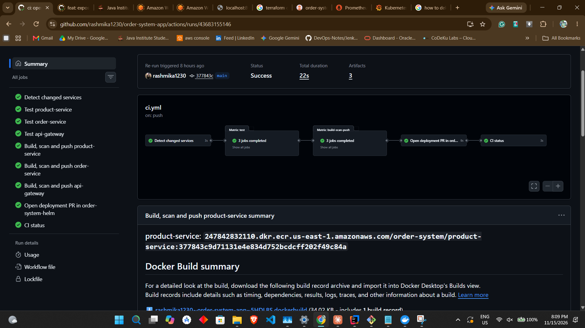
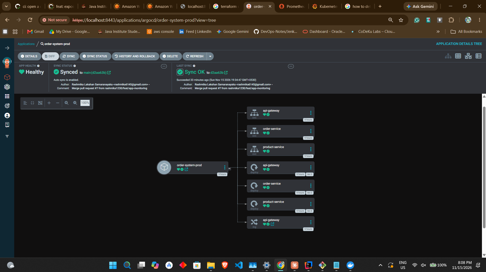
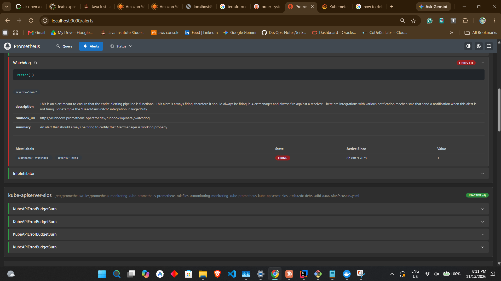

# Order System: Spring Boot microservices with a production-style GitOps pipeline

Three Spring Boot services deployed to AWS through a fully automated, reviewed pipeline:
**GitHub Actions → Amazon ECR → pull request → Argo CD → k3s**, with infrastructure in
Terraform and monitoring with Prometheus and Grafana.

The business logic is deliberately small. The focus is on how a change gets from a
developer's laptop to production safely, and how the system behaves when things go wrong.

> The AWS environment was torn down after the project. All infrastructure is code, so it can
> be recreated with `terraform apply`. Screenshots below were taken from the running system.

## Architecture

| Service | Responsibility |
|---|---|
| **api-gateway** | Spring Cloud Gateway. Single public entry point; only allow-listed routes are exposed |
| **product-service** | Products and stock. Atomic stock reservation |
| **order-service** | Places orders by reserving stock in product-service; stores a price snapshot |

## Delivery pipeline

- **Path-filtered:** only the services that changed are tested, built and deployed
- **No stored AWS keys:** GitHub Actions authenticates with OIDC; the IAM role trusts only `main` of this repository
- **Scan before push:** an image with a fixable critical vulnerability never reaches ECR
- **Approval gate:** production changes only when a deployment PR is merged. Rollback = revert that PR
- **Supply-chain safety:** every GitHub Action is pinned to a commit SHA and kept current by Dependabot

## Repositories

| Repository | Contents |
|---|---|
| [order-system-app](https://github.com/rashmika1230/order-system-app) | Service code, tests, Dockerfiles, CI pipeline (this repo) |
| [order-system-helm](https://github.com/rashmika1230/order-system-helm) | Helm chart, environment values, Argo CD and monitoring configuration |
| [order-system-infra](https://github.com/rashmika1230/order-system-infra) | Terraform: VPC, EC2/k3s, RDS, ECR, IAM, GitHub OIDC |

## Tech stack

**Application:** Java 17, Spring Boot 4.1, Spring Cloud Gateway, Spring Data JPA, Flyway, MySQL 8.4, HTTP interface clients 
**Testing:** JUnit 5, Mockito, `@WebMvcTest`, Testcontainers (real MySQL) 
**Delivery:** Docker (multi-stage, non-root), GitHub Actions, Trivy, Amazon ECR, Helm, Argo CD 
**Infrastructure:** Terraform (S3 backend with native locking), AWS VPC, EC2, RDS, IAM, SSM, k3s 
**Observability:** Micrometer, Prometheus, Grafana, Alertmanager

## Engineering decisions

- **Database per service.** Each service has its own schema and its own MySQL user; one service cannot read the other's data
- **Atomic stock reservation.** One `UPDATE ... WHERE stock >= ?` prevents overselling under concurrency, proven by a 10-thread integration test
- **No transaction around network calls.** `createOrder` calls product-service outside a DB transaction, so a slow dependency cannot exhaust the connection pool
- **Timeouts and graceful degradation.** If product-service is down, order-service returns a clean `503`, not a stack trace
- **Defence in depth.** RDS in private subnets reachable only from the node's security group; Kubernetes API open only to the admin IP; no SSH (SSM Session Manager); containers run as non-root with a read-only filesystem
- **Secrets never in Git.** DB passwords are generated by Terraform into SSM Parameter Store; the RDS master password is managed by Secrets Manager

## Proven by breaking it

| Test | What happened |
|---|---|
| Removed input validation in a PR | Regression test failed, merge blocked by branch protection |
| Scaled product-service to zero | Orders returned `503`; `OrderSystemServiceUnavailable` and `OrderSystemHighErrorRate` alerts fired |
| Manual `kubectl scale` in production | Argo CD self-healed back to the state in Git |
| Reverted a deployment PR | Argo CD rolled back; the database stayed compatible because migrations are backward-compatible |

## Problems I ran into and solved

- **GitHub's 2026 OIDC change.** New repositories now send an immutable subject claim (`owner@id/repo@id`), so the IAM trust policy rejected the token. Diagnosed it and updated the trust policy to the new format
- **Argo CD and Helm hooks.** kube-prometheus-stack's admission-webhook Jobs looped forever, because Argo CD re-runs Helm hooks on every sync and treated the patched webhooks as drift
- **Grafana OOMKilled.** A memory limit set by guesswork caused a restart loop and a failed rollout; fixed using measured usage
- **`runAsNonRoot` failed** with a named user in the image; switched to a numeric UID
- **Wrong kubectl context.** A stale kubeconfig pointed at an old EKS cluster; now I check `current-context` before any change
- **Exposed credential.** A database admin password was exposed during debugging; I rotated it through Secrets Manager and changed my workflow so secrets are never displayed
- **Trivy supply-chain incident (March 2026).** Pinned all actions to commit SHAs instead of movable tags

## Known limitations and next steps

- Stock is not released if saving an order fails after a successful reservation (Saga pattern / compensating action)
- Single node, single AZ, HTTP only (no domain); would move to EKS or multi-node with TLS via cert-manager
- Alertmanager → Slack routing, External Secrets Operator, SonarCloud, and a Terraform plan/apply pipeline

## Run locally

Prerequisites: Docker Desktop.

    cp .env.example .env
    docker compose --profile app up -d --build

API at `http://localhost:8080/api/products`.
